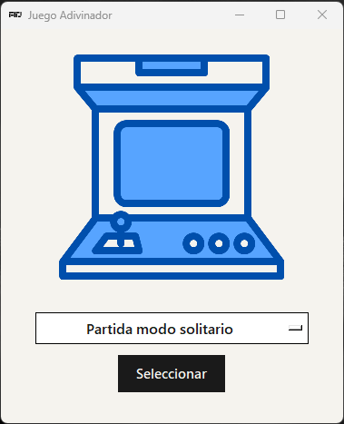
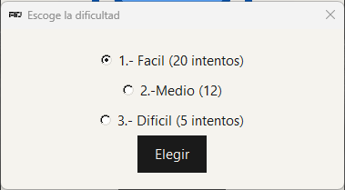
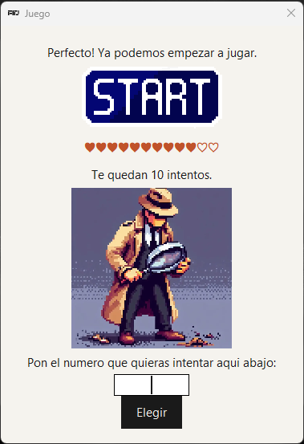
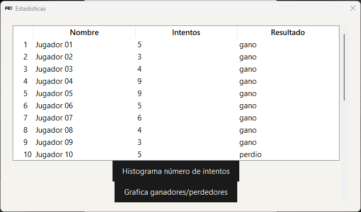

# Juego Adivinador — a number-guessing game with a Tkinter GUI

A small desktop game written in Python with **Tkinter**: guess a number between 1 and 1000 before your
lives run out. My first GUI project, built for the Python course of the MSc in Data Science at
Universidad Complutense de Madrid. The interface is in Spanish.

| Menu | Difficulty | Playing | Statistics |
|---|---|---|---|
|  |  |  |  |

## Features

- **Two modes:** solo (the computer picks the number) or two players (player 1 types a hidden number).
- **Three difficulty levels** (20, 12 or 5 attempts), shown as hearts that empty as you miss.
- **Higher / lower hints** after each guess, with keyboard-only play (Enter to submit).
- **Persistent statistics** in an Excel file (`openpyxl`): every game is logged and shown in a table,
  with a histogram of attempts and a wins-vs-losses chart (`matplotlib`).
- Modal windows (`transient` + `grab_set`) so the player cannot click on the window underneath.

## Run

```bash
pip install openpyxl matplotlib
python game.py
```

`game.py` is the current version, with a cleaner visual theme. `FinalTkinter.ipynb` is the original
notebook as submitted. `datosjug.xlsx` ships with sample players.

---
Miguel Ángel Castro Torreslanda · [mtorreslanda.com](https://mtorreslanda.com)
